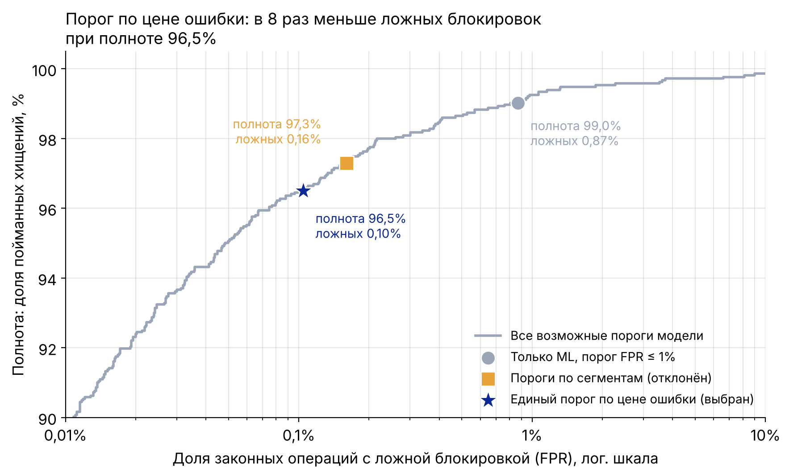

# Хакатон ВТБ «Деньги под защитой» — антифрод: модели и симуляция (Р1)

CL Cup Moscow 2026, 1 тур, кейс ВТБ. Здесь ML-часть решения: модели выявления мошеннических операций, подбор порогов по цене ошибки, симуляция многоуровневой реакции и сравнение вариантов решения.

Кейс просит не расписывать устройство алгоритма на слайдах, поэтому код и расчёты лежат здесь как приложение к презентации.

## Главные результаты

| Что | Результат | Где |
|---|---|---|
| Бейзлайн PaySim против действующего правила | полнота 73,0% против 0,3%; остановлено 82,2% суммы против 1,1% | `01` |
| Основная модель Sparkov (профиль с задержкой 24 ч) | полнота 99,0%, ложных 0,87%, PR-AUC 0,975 | `02` |
| Задержка данных клиента на сутки | PR-AUC 0,974 → 0,975, качество не теряется | `02` |
| Порог по цене ошибки | в 8 раз меньше ложных блокировок (578 против 4 821) при полноте 96,5% | `03` |
| Многоуровневая реакция против бинарной приостановки | похищено −8,4%, ошибочных ограничений −30,2%, потеря NPS −21,7%, TP −0,85% | `03` |
| Сравнение 4 вариантов решения | выбранный гибрид: наименьшие потери и 0,07% ошибочных ограничений | `03`, раздел 4 |



Все цифры посчитаны на отложенном по времени тесте. На слайды выносим относительные эффекты: данные не российские, их перенос на базу ВТБ — лист «Эффект и NPS» (Р4).

## Структура

```
notebooks/
  01_paysim_baseline.ipynb              №8   EDA PaySim, проверка утечки, бейзлайн
  02_sparkov_segments.ipynb             №14  сегменты 18–25 / 26–59 / 60+, история клиента, задержка 24 ч
  03_thresholds_reaction_options.ipynb  №17, №18, №32  пороги, реакция, сравнение вариантов
antifraud_utils.py   №6  общие функции: сплит по времени, метрики кейса, история без утечки, цена ошибки, симуляция
results/             таблицы и графики из запусков на Kaggle
tools/               синтетические данные и запуск ноутбуков для проверки кода
```

Ноутбуки сохранены вместе с результатами выполнения: таблицы и графики видны на GitHub без запуска.

## Данные

| Датасет | Kaggle | Зачем |
|---|---|---|
| PaySim | [ealaxi/paysim1](https://www.kaggle.com/datasets/ealaxi/paysim1) | Переводы и вывод наличных: сценарий вывода через дропов |
| Sparkov | [kartik2112/fraud-detection](https://www.kaggle.com/datasets/kartik2112/fraud-detection) | Дата рождения (сегменты) и длинная история клиента |
| IEEE-CIS | [ieee-fraud-detection](https://www.kaggle.com/c/ieee-fraud-detection) | Реальные платежи с признаками устройства — часть Р2 (Ефимова Арина) |

Датасеты в репозиторий не входят: они скачиваются с Kaggle по их лицензиям.

**Почему не российские данные.** Открытых данных о мошеннических операциях в российских банках нет (банковская тайна). Поэтому подход проверен на открытых датасетах, а переносятся относительные изменения.

**Рубли.** Суммы датасетов пересчитаны так, чтобы средняя сумма хищения в тесте равнялась средней сумме ОБДС по данным ЦБ за 2025 год — 18,6 тыс. руб. (кейс, с. 7). Это рубли за тестовый период датасета, а не годовой эффект для ВТБ.

## Метрики (формулы кейса, с. 10)

| Метрика | Формула |
|---|---|
| Точность выявления | TP / (TP + FP) |
| Доля ложных сигналов | FP / (TP + FP) |
| Ложные среди законных (FPR) | FP / (FP + TN) |
| Полнота обнаружения | TP / (TP + FN) |
| Доля остановленной суммы | сумма пойманных хищений / сумма всех хищений |

**Ложные сигналы и ошибочно ограниченные операции считаются отдельно**, как требует кейс. Ложный сигнал — законная операция получила любую реакцию, в том числе мягкое предупреждение. Ошибочное ограничение — законная операция в итоге не состоялась.

## Ключевые решения

**Сплит по времени.** Train — ранние операции, test — поздние. Случайный сплит подмешивает будущее и завышает метрики.

**Утечка в PaySim.** Колонки балансов записаны после операции, а у мошеннических переводов симулятор не обновляет баланс получателя. Модель на них даёт почти 100%. В решении балансы не используются, модель «с балансами» оставлена только как доказательство утечки.

**История клиента без утечки.** Все признаки истории считаются строго по прошлым операциям (`past_stats`).

**Задержка данных до суток** (условие кейса). Профиль клиента (средняя сумма, привычные категории) считается с задержкой 24 ч, онлайн — только всплески операций за 1 ч и 24 ч. Качество не падает, что обосновывает схему «онлайн-признаки + ночной профиль».

**Порог по цене ошибки.** Цена пропуска — сумма хищения. Цена ложной блокировки — 222 руб.: обращение в КЦ и недополученный доход (лист «Допущения», стр. 75). Порог подбирается на валидации, проверяется на тесте.

**Пороги по сегментам отклонены.** По полной цене они дешевле на 4,6%, но дают на 53% больше ложных блокировок. Модель с историей клиента и так выравнивает качество по сегментам, а различия сегментов учтены в уровнях реакции (для 60+ — живой звонок вместо текста).

**Пять уровней реакции:** пропустить → предупреждение → доп. подтверждение (биометрия или вопрос «вам сейчас звонят?») → звонок банка → приостановка по 161-ФЗ. Для каждой операции выбирается уровень с максимальной ожидаемой выгодой. Приостановка разрешена только выше текущего порога, правило 161-ФЗ всегда ведёт к приостановке. Обязательные меры 161-ФЗ (12 признаков ЦБ, база ЦБ, период охлаждения) применяются до модели и не ослабляются; на Sparkov их нельзя воспроизвести, поэтому слой правил представлен прокси «крупная сумма ночью».

## Допущения

Экономические параметры взяты с листа «Допущения» (Р4), номер строки указан в первой ячейке ноутбука 03: стоимость обращения в КЦ 181 руб., доход с клиента 977 руб./мес., доля проходящих подтверждение 75%, доля бросивших платёж 0,5%, разница NPS −30 п.п. и др.

Эффективность уровней реакции против мошенничества — допущения Р1, банки эту конверсию не публикуют:

| Уровень | Доля остановленных хищений | Опора |
|---|---|---|
| Предупреждение | 20% (60+: 10%) | не выше 33%: столько клиентов читают предупреждения (Opinium / Tunic Pay) |
| Доп. подтверждение | 45% | открытых данных нет |
| Звонок банка | 75% (60+: 85%) | открытых данных нет |
| Приостановка | 95% | ниже общесистемных 97,4% по данным ЦБ за II кв. 2026 |

Чувствительность (27 сценариев: доля бросивших 1% / 0,5% / 0,25%, проходящих подтверждение 65% / 75% / 85%, эффективность мягких уровней ×0,7 / ×1 / ×1,3): похищено −4…−12%, ошибочно ограничено −28…−61%, итоговые потери −2…−10%. Вывод устойчив (`results/reaction_sensitivity.csv`).

## Как запустить

**На Kaggle.** Импортировать ноутбук (File → Import Notebook), подключить данные (Add Input), Run All.

| Ноутбук | Input | Время |
|---|---|---|
| 01 | `ealaxi/paysim1` | ~3 мин |
| 02 | `kartik2112/fraud-detection` | ~5–15 мин |
| 03 | сохранённая версия ноутбука 02 (Your Work), нужен `sparkov_scores.csv.gz` | ~1 мин |

**Локально.** `pip install lightgbm pandas scikit-learn matplotlib`, затем указать папки: `DATA_DIR=путь/к/данным OUT_DIR=output`.

**Проверка кода без данных** — на синтетике с той же структурой колонок:

```bash
pip install lightgbm nbformat nbclient ipykernel
python tools/make_synthetic.py /tmp/synth
DATA_DIR=/tmp/synth OUT_DIR=/tmp/out python tools/run_nb.py notebooks/01_paysim_baseline.ipynb /tmp/out/01.ipynb
```

## Результаты (`results/`)

| Файл | Что | Куда в таблице команды |
|---|---|---|
| `metrics_paysim.csv` | метрики PaySim | «Метрики моделей» |
| `metrics_sparkov_segments.csv` | метрики Sparkov по сегментам | «Метрики моделей» |
| `thresholds_total.csv` | три варианта порога | «Метрики моделей» |
| `reaction_before_after.csv` | многоуровневая реакция: до / после | «Метрики моделей», блок реакции |
| `values_for_sheet.csv` | готовые значения | «Допущения» 86–92, «Цифры в деке» 11–12 |
| `options_comparison.csv` | сетка 4 вариантов (№32) | слайд 4 |
| `reaction_by_segment.csv`, `thresholds_by_segment.csv`, `reaction_sensitivity.csv` | детализация по сегментам и 27 сценариев чувствительности | приложение |
| `recall_vs_fpr_slide.png` | график для слайда: полнота vs ложные блокировки | слайд с порогами |
| `*.png` | остальные графики | приложение |

## Команда

| Роль | Участник | Часть |
|---|---|---|
| Р1 | Михайлова Ангелина | модели PaySim и Sparkov, пороги, симуляция реакции, сравнение вариантов |
| Р2 | Ефимова Арина | IEEE-CIS, SHAP-объяснения, схема технических блоков |
| Р3 | Сорокина Лиза | клиентский путь, BPMN, регуляторика |
| Р4 | Антонова Алина | допущения, смета, экономический эффект |
| Р5 | Данил Васимов | фокус, сценарии, дека, координация |
